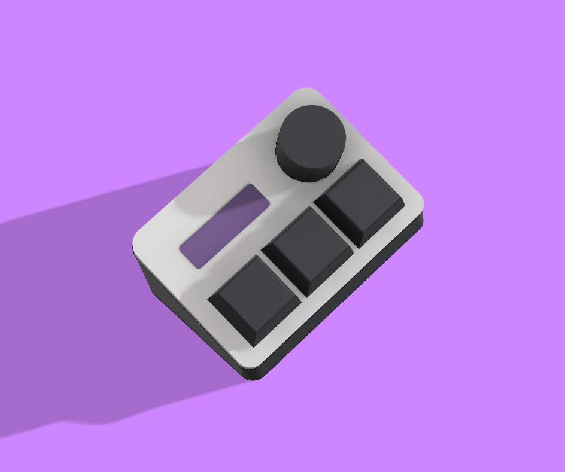
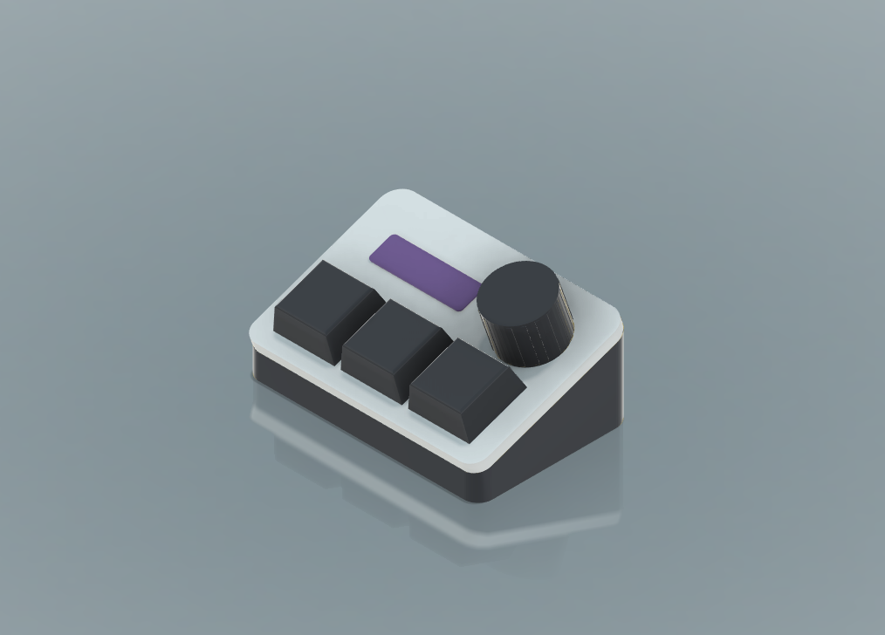
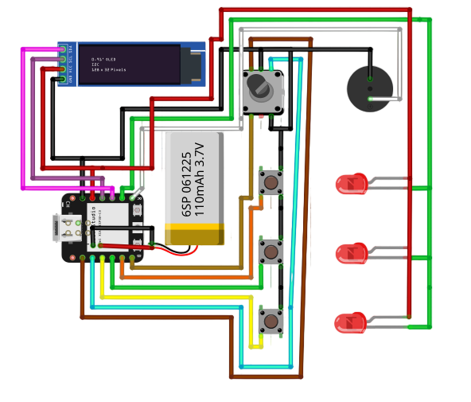

Octoglow Macro Duo is a compact macro pad designed for on-the-go devices; it can connect via Bluetooth and USB and offers 10 hours of continuous battery life while on the go. It features an OLED display, three buttons, and one programmable button, as well as backlighting. 

I built this macro pad because I needed a simple, portable solution that wasn't fragile and had both Bluetooth and USB connectivity.

Seed Esp32 S3 Plus Schematics

RP2040 (you can use the WS or seed mini versions) Model Schematics

For the ESP32 s3 Plus model:

1. Open esp32s3.ino in the Arduino IDE (You can get it form /Firmware/)
2. Install the ESP32 board package from Boards Manager, if you don't have it yet.
3. Install the required libraries from the Library Manager
4. Select your board and the correct serial port.
5. Upload the firmware.

For the RP2040 model:

1. Open rp2040.ino in the Arduino IDE (You can get it form /Firmware/)
2. Install the Rp2040 board package from Boards Manager, if you don't have it yet.
3. Install the required libraries from the Library Manager
4. Select your board and the correct serial port.
5. Upload the firmware.

### ESP32-S3 Plus

| Component | Quantity | Unit Price (USD) | Total Price (USD) |
|---|---:|---:|---:|
| [Seeed Studio XIAO ESP32-S3 Plus](https://www.seeedstudio.com/Seeed-Studio-XIAO-ESP32S3-Plus-p-6361.html) | 1 | $7.900000 | $7.9000 |
| [Li-Pol battery - 160 mAh, 3.7 V, 401040](https://ampul.eu/ro/baterii/6783-baterie-li-pol-160mah-37v-401040) | 1 | $4.622709 | $4.6227 |
| [Encoder - EC11 rotary with click, 20 mm](https://sigmanortec.ro/Encoder-rotativ-cu-click-20mm-EC11-p128736611) | 1 | $0.918591 | $0.9186 |
| [OLED display - I2C, 0.91 inch, 128x32](https://sigmanortec.ro/Display-OLED-IIC-I2C-0-91-128x32-p126091015) | 1 | $3.802004 | $3.8020 |
| [Passive buzzer - 5 V](https://sigmanortec.ro/Buzzer-pasiv-5v-p172425809) | 1 | $0.303407 | $0.3034 |
| [Dupont wires - 40 pack, 10 cm, male to male](https://sigmanortec.ro/40-fire-Dupont-10cm-Tata-Tata-p210856288) | 1 | $1.617473 | $1.6175 |
| [Outemu Blue switches - 10 pack](https://qwertykey.ro/products/switchuri-outemu-blue) | 1 | $1.883216 | $1.8832 |
| [Red LED - 5 mm](https://sigmanortec.ro/led-5mm-rosu) | 3 | $0.062774 | $0.1883 |
| QwertyKey shipping | 1 | $3.138694 | $3.1387 |
| Sigmanortec shipping | 1 | $3.138694 | $3.1387 |
| Seeed Studio shipping | 1 | $12.300000 | $12.3000 |
| AMPUL shipping | 1 | $6.100185 | $6.1002 |
| **GRAND TOTAL** |  |  | **$45.9133** |

### RP2040

| Component | Quantity | Unit Price (USD) | Total Price (USD) |
|---|---:|---:|---:|
| [RP2040 development board - 2 MB flash](https://sigmanortec.ro/placa-dezvoltare-compatibila-rp2040-cortex-m0-2mb-flash) | 1 | $4.289548 | $4.2895 |
| [Encoder - EC11 rotary with click, 20 mm](https://sigmanortec.ro/Encoder-rotativ-cu-click-20mm-EC11-p128736611) | 1 | $0.918591 | $0.9186 |
| [OLED display - I2C, 0.91 inch, 128x32](https://sigmanortec.ro/Display-OLED-IIC-I2C-0-91-128x32-p126091015) | 1 | $3.802004 | $3.8020 |
| [Passive buzzer - 5 V](https://sigmanortec.ro/Buzzer-pasiv-5v-p172425809) | 1 | $0.303407 | $0.3034 |
| [Dupont wires - 40 pack, 10 cm, male to male](https://sigmanortec.ro/40-fire-Dupont-10cm-Tata-Tata-p210856288) | 1 | $1.617473 | $1.6175 |
| [Outemu Blue switches - 10 pack](https://qwertykey.ro/products/switchuri-outemu-blue) | 1 | $1.883216 | $1.8832 |
| [Red LED - 5 mm](https://sigmanortec.ro/led-5mm-rosu) | 3 | $0.062774 | $0.1883 |
| QwertyKey shipping | 1 | $3.138694 | $3.1387 |
| Sigmanortec shipping | 1 | $3.138694 | $3.1387 |
| **GRAND TOTAL** |  |  | **$19.2799** |

AI contributed to this project in the following ways:
- Helped me choose efficient components for my schematics for the esp32 S3 model
- Was involved in firmware development 